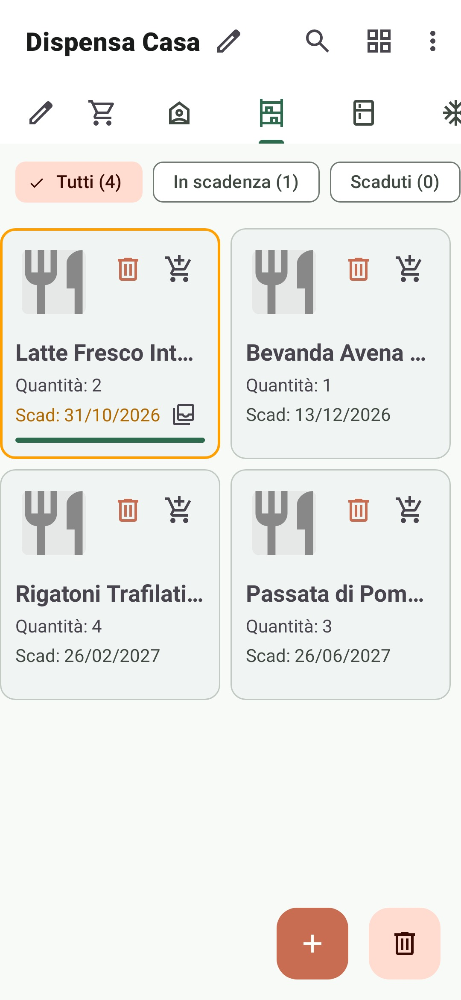
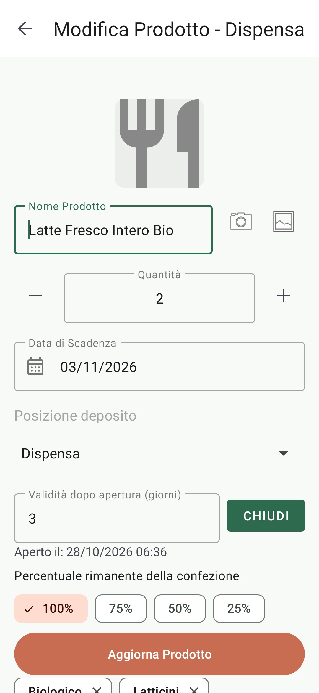
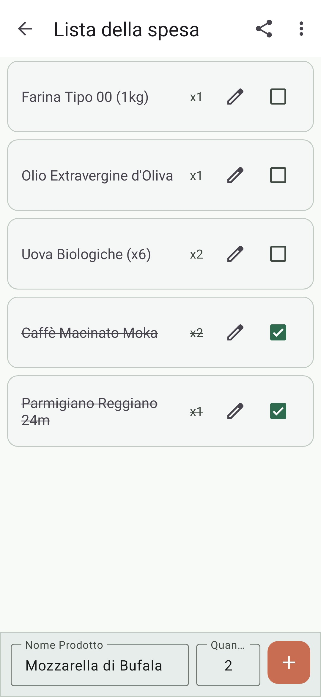
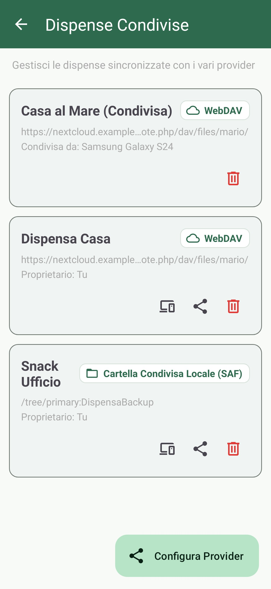
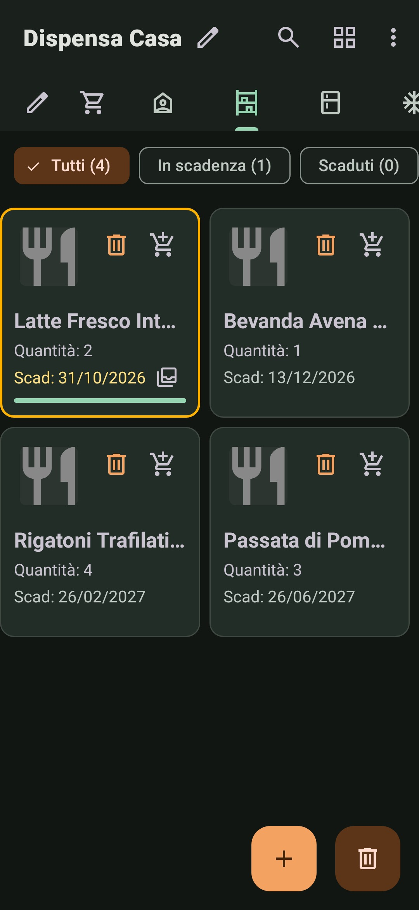
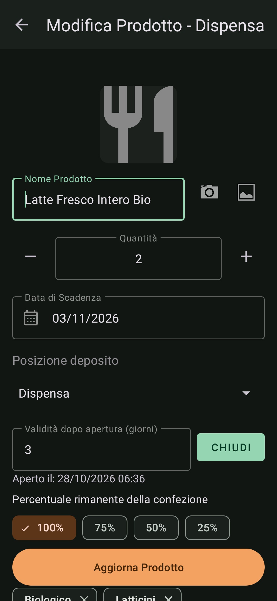
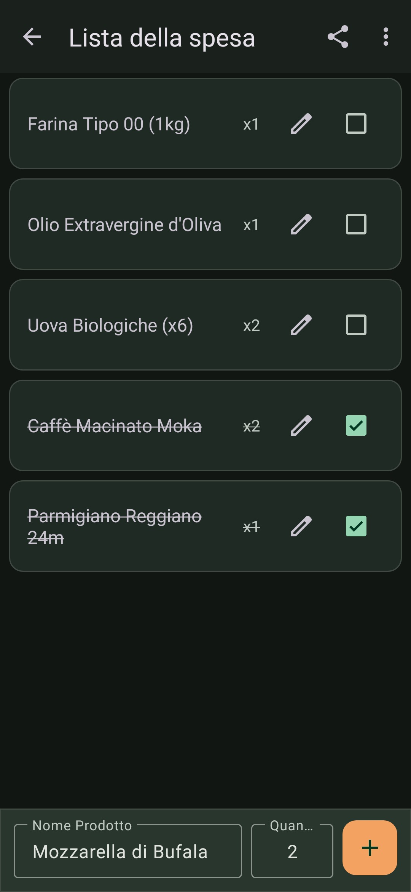
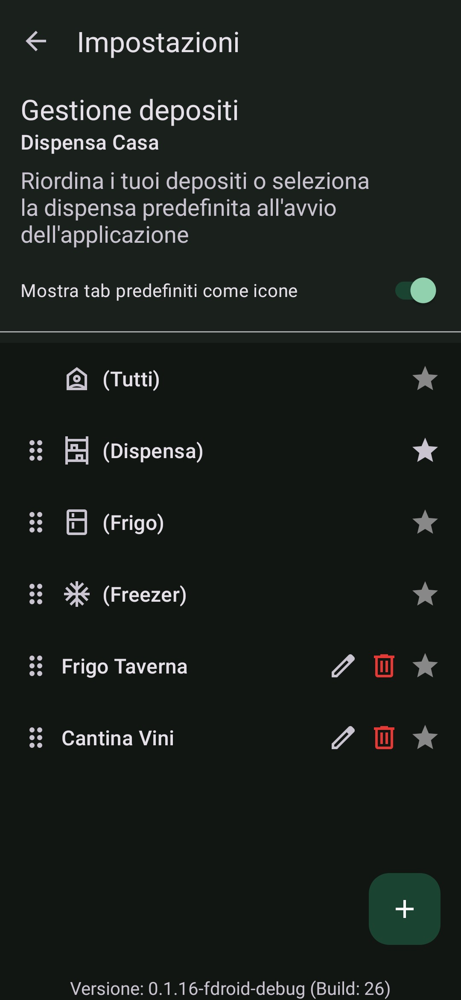

# 📦 Dispensa

Applicazione Android nativa, modulare e offline-first per la gestione della dispensa domestica, il tracciamento intelligente delle scadenze alimentari e la sincronizzazione decentralizzata multi-dispositivo crittografata end-to-end.

🌐 **Sito ufficiale e documentazione:** [dispensa-app-frigo.web.app](https://dispensa-app-frigo.web.app/)

---

## 📱 Nuova Esperienza Utente (UX) e Funzionalità

Dispensa è progettata per offrire un controllo rapido e intuitivo sulle scorte domestiche, riducendo al minimo gli sprechi alimentari grazie a un'interfaccia Material 3 reattiva e moderna:

- **Dashboard Scorte & Filtri Rapidi:** visualizzazione immediata degli articoli con indicatori cromatici dello stato di scadenza (scaduti, in scadenza oggi/a breve, regolari). Filtri istantanei per stato (*Tutti*, *In Scadenza*, *Aperti*), categorie e collocazioni.
- **Tracking Prodotti Aperti & Consumo Percentuale:** possibilità di contrassegnare gli articoli aperti e monitorarne la percentuale di consumo residuo direttamente dalla card prodotto.
- **Inserimento Rapido & Scansione Intelligente:**
  - Scansione barcode integrata con interrogazione automatica OpenFoodFacts e sistema di cache locale offline per operare senza connessione.
  - OCR con riconoscimento testo su fotocamera per rilevamento rapido della data di scadenza.
- **Gestione Lotti & Date Multiple:** supporto a scadenze multiple per lo stesso prodotto con gestione delle quantità per lotto.
- **Collocazioni Personalizzabili:** suddivisione fisica delle scorte per ambienti (es. Frigo, Freezer, Dispensa, Cantina) con filtri dedicati.
- **Lista della Spesa Sincronizzata:** reintegro immediato dei prodotti esauriti o aggiunta rapida manuale, con spunta degli articoli acquistati.
- **Notifiche Scadenze Puntuali:** notifiche locali schedulate in background tramite Android WorkManager (`ExpiryCheckWorker`), configurabili per orario e giorni di anticipo.
- **Design Adattivo Material 3:** supporto completo a temi Light e Dark, colori dinamici e layout ottimizzati per l'uso quotidiano.
- **Supporto Multilingua:** localizzazione completa in Italiano, Inglese e Tedesco.

---

## 📸 Screenshots

| Dispensa (Light) | Dettaglio / Aggiunta (Light) | Lista Spesa (Light) | Dispensa Condivisa (Light) |
|:---:|:---:|:---:|:---:|
|  |  |  |  |

| Dispensa (Dark) | Dettaglio / Aggiunta (Dark) | Lista Spesa (Dark) | Collocazioni (Dark) |
|:---:|:---:|:---:|:---:|
|  |  |  |  |

---

## 🏗️ Architettura & Modularità

Il progetto segue i principi dell'architettura pulita (Clean Architecture) con pattern **MVVM (Model-View-ViewModel)**, disaccoppiamento dei layer tramite moduli Gradle indipendenti e pattern Event-Sourcing per la sincronizzazione:

```text
dispensa/
├── app/          # UI Layer: Activity, Fragment, ViewModel, ViewBinding, WorkManager Workers
├── dbcore/       # Data Layer: Room Database, Entità SQLite, DAO, Repository, Cache OpenFoodFacts
├── sync-core/    # Sync Engine: Event-sourcing (PantryEvent), Manifest, Snapshot, CryptoEngine
├── sync-webdav/  # Sync Provider: Storage remoto su WebDAV (Nextcloud, ownCloud)
├── sync-local/   # Sync Provider: Storage locale / SAF (Storage Access Framework)
└── sync-gdrive/  # Sync Provider: Google Drive AppData (esclusivo flavor 'play')
```

### Componenti Chiave

- **Reattività & Threading:** combinazione di LiveData e RxJava3 con esecuzione asincrona su worker thread dedicati per DAO e networking.
- **Persistenza & Migrazioni:** Android Room con schema SQLite esportato e tracciato (`dbcore/schemas`).
- **Sincronizzazione Decentralizzata:**
  - Architettura Zero-Knowledge senza server proprietari centralizzati, basata su snapshot ed eventi crittografati con AES-GCM.
  - Generazione e pairing crittografico sicuro tramite QR Code e link di condivisione (`ShareLinkCodec`).
  - Provider intercambiabili caricati modularmente (`SyncProviderLoader`).
- **Background Processing:** Android WorkManager per il controllo periodico affidabile delle scadenze senza impatto negativo sulla batteria.

---

## 🏷️ Product Flavors

Il progetto adotta la flavor dimension `store` per separare la versione distribuita su Google Play Store da quella FOSS per F-Droid:

| Flavor | Target | Dipendenze Barcode & OCR | Provider Sync Inclusi |
|:---|:---|:---|:---|
| **`play`** | Google Play Store | Google Play Services ML Kit (Barcode + Text Recognition) | WebDAV, SAF Locale, Google Drive |
| **`fdroid`** | F-Droid (100% FOSS) | ZXing Android Embedded (senza librerie proprietarie Google) | WebDAV, SAF Locale |

---

## 🛠️ Stack Tecnologico

- **Linguaggi:** Java 21+ & Kotlin
- **Android SDK:** `minSdk 27` (Android 8.1+) • `targetSdk 36` • `compileSdk 36`
- **Build System:** Gradle con Kotlin DSL (`build.gradle.kts`) e Version Catalog (`gradle/libs.versions.toml`)
- **UI & Layout:** ViewBinding, Material Components 3, Android Navigation Component
- **Database:** Room (SQLite) con migrazioni di versione testate
- **Networking:** Retrofit 2, OkHttp 3, Gson
- **Background Tasks:** AndroidX WorkManager

---

## 💻 Build & Sviluppo

### Prerequisiti
- **JDK:** OpenJDK 21 o superiore (consigliato OpenJDK 23)
- **Android Studio:** Versione recente compatibile con Gradle 8.x
- **Android SDK:** Platform 36 e relativi Build Tools

### Comandi Gradle

#### Compilazione Varianti Debug
```bash
# Versione Google Play Debug
./gradlew assemblePlayDebug

# Versione F-Droid (FOSS) Debug
./gradlew assembleFdroidDebug
```

#### Compilazione Varianti Release
```bash
# APK Release F-Droid
./gradlew assembleFdroidRelease

# Bundle .aab Release Play Store
./gradlew bundlePlayRelease
```

#### Esecuzione Test & Lint
```bash
# Esegui gli unit test del modulo app
./gradlew :app:testPlayDebugUnitTest

# Test unitari database e motore di sincronizzazione
./gradlew :dbcore:test
./gradlew :sync-core:test

# Esegui tutti i test del progetto
./gradlew test

# Analisi statica con Android Lint
./gradlew lint
```

---

## 🔒 Privacy & Filosofia Offline-First

- **Zero Tracciamento:** nessuna telemetria, nessun servizio di analytics di terze parti o profilazione.
- **Controllo Totale dei Dati:** il database risiede interamente in locale sul dispositivo.
- **Crittografia End-to-End:** la sincronizzazione facoltativa cifra i dati localmente prima della trasmissione su storage WebDAV, Google Drive o cartella SAF.
